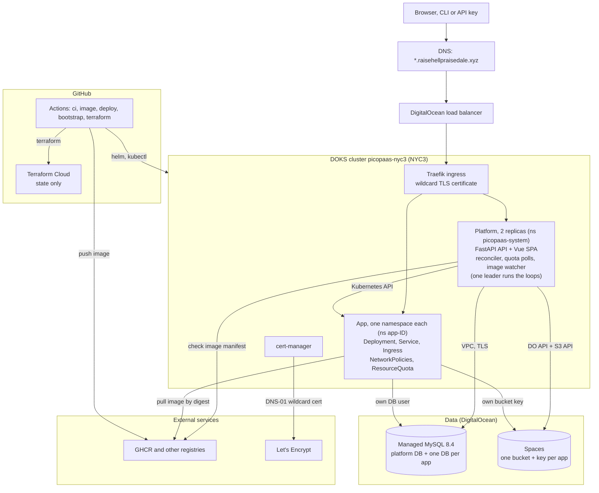
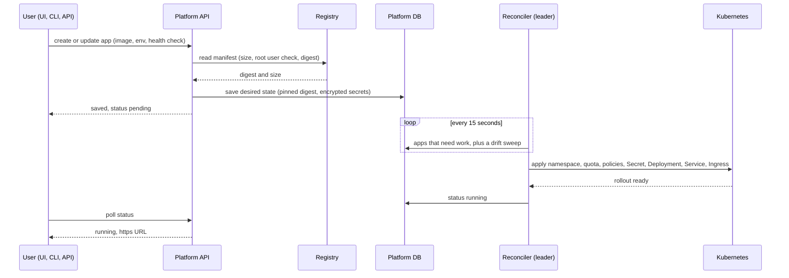

# PicoPaaS

A tiny Heroku-style PaaS for quick throwaway projects. You give it one Docker image, add env vars and secrets,
and optionally get a MySQL database (50 MB) and an S3-compatible storage bucket (100 MB). Each app gets its own HTTPS
subdomain. It runs on DigitalOcean Kubernetes for about $60/mo.

Live: https://platform.raisehellpraisedale.xyz (an administrator approves every new account)

Docs: [User guide](docs/USER_GUIDE.md) | [API](docs/API.md) | [CLI](docs/CLI.md) | [Operations](docs/OPERATIONS.md) | [Architecture](docs/ARCHITECTURE.md) | [Pentest notes](docs/PENTEST.md) | [Ledger](docs/LEDGER.md)

## Features

- One Docker image per app, public registries (GHCR, Docker Hub, etc.).
- Env vars and encrypted secrets. Reference values with `${{ db.url }}`, `${{ storage.bucket }}` and friends.
- Optional MySQL database and storage bucket per app, each with its own credentials.
- HTTPS subdomain per app (`<adjective>-<animal>-<id>.raisehellpraisedale.xyz`) from a wildcard certificate.
- Logs, restart, and live status in the UI.
- Digest pinning: every deploy runs a `sha256` digest. Floating tags (`:latest`) are re-checked every 10 minutes and
  auto-redeployed when they move.
- Quotas on CPU, memory, scratch disk, image size, database size and bucket size.
- Administrator approval for new accounts, user and app suspend or delete, and an audit log.
- API keys, a CLI, and a YAML app spec.

## Caps

Single source of truth: [`app/config.py`](app/config.py) (env-overridable).

| What | Cap |
|---|---|
| CPU | 100m limit (64m request) |
| Memory | 384 MB limit (128 MB request) |
| Scratch disk | 250 MB (pod is evicted over it) |
| Image size | 256 MB compressed |
| MySQL database | 50 MB (writes revoked over it) |
| Storage bucket | 100 MB (key goes read-only over it) |
| Apps per user | 1 by default (an administrator can raise it) |

## Architecture



What happens when you deploy an app:



## Tech stack

| Layer | Tech | Why |
|---|---|---|
| API | FastAPI, SQLAlchemy 2, Alembic, PyMySQL | Small, typed, easy to test; migrations on startup (`entrypoint.sh`) |
| Background jobs | APScheduler, in the API process | No separate operator. Reconcile every 15s, DB quota every 60s, bucket quota every 5 min, image watcher every 10 min. A MySQL `GET_LOCK` picks one leader among replicas |
| Auth | bcrypt, JWT session cookie, `pp_sk_` API keys | UI sessions plus keys for CLI and CI |
| Frontend | Vue 3, Vite, Pinia, Vue Router, Tailwind, lucide icons | Built into the API image and served as static files |
| Compute | Kubernetes on DigitalOcean (DOKS) | Namespaces, quotas and NetworkPolicy give per-app isolation; free control plane |
| Ingress | Traefik (standard Ingress API) | ingress-nginx is retired; one default TLS store serves the wildcard cert |
| TLS | cert-manager, Let's Encrypt, DNS-01 via DO | One wildcard cert, so no per-app issuance or rate limits |
| Metrics | metrics-server | CPU and memory in the admin health view |
| Database | DO Managed MySQL 8.4 | Platform DB plus one database and user per app, over the VPC with TLS |
| Object storage | DO Spaces (S3 API, boto3) | A bucket and access key per app |
| Secrets at rest | Fernet (`cryptography`), MultiFernet for rotation | One platform key encrypts env secrets, DB and bucket credentials |
| Infra as code | Terraform with Terraform Cloud state | Cluster, VPC, MySQL, firewall, Spaces bucket, DNS |
| CI/CD | GitHub Actions, GHCR | Public repo and images, so both are free |
| Secret scanning | gitleaks pre-commit hook, plus a CI guard against allowlists | Keeps keys out of git |
| Tests | pytest (SQLite in memory, real login flow), Playwright e2e | Infra clients are faked behind interfaces; e2e and pentest suites run against the live site |

## How it works

**Desired state lives in the platform DB.** The API validates a request, reads the image manifest (size cap, non-root
check, digest), stores the app, and returns. A reconciler loop inside the API process runs every 15 seconds and
converges Kubernetes, MySQL and Spaces toward what the DB says. It renders the manifests, hashes them, and applies
only on change. A drift sweep re-checks running apps against that hash, so a deleted namespace or a rebuilt cluster
gets repaired. Two replicas run, but only the one holding a MySQL named lock does the work.

**Isolation.** Every app gets its own namespace with a ResourceQuota and LimitRange. Pods run non-root with Pod
Security Admission set to `restricted`, no service account token, and no privilege escalation. NetworkPolicies deny
everything by default: ingress only from Traefik, egress to the internet and to MySQL, nothing to other apps, and SMTP
ports are blocked. Each app gets its own DB user and bucket key, never the platform's.

**Quota enforcement.** MySQL and Spaces have no per-tenant quotas, so the platform polls sizes itself. Over 50 MB, an
app's DB user loses INSERT, UPDATE and CREATE, its open sessions are killed, and the pod is rolled if that can't be
confirmed. Over 100 MB, the bucket key swaps to read-only. Users can free space and get write access back.

**Image watcher.** Apps deploy a pinned digest. For floating tags, a job re-resolves the tag every 10 minutes, checks
the new image against the caps, and redeploys when the digest moved. A bad new image (too big, root user) is rejected
and the old one keeps running.

**Secrets.** Env var values, DB passwords and bucket keys are Fernet-encrypted in the platform DB. They are decrypted
only when the reconciler writes the app's Kubernetes Secret. `FERNET_KEY` lives in a GitHub secret and a k8s Secret, and
rotation is supported.

## Cost

About $60/mo baseline (node, managed MySQL, load balancer, Spaces) and about $88 while the autoscaler runs a second
node. Per-app cost is about $0 until the node fills up. Details, sources and what we couldn't verify:
[docs/ARCHITECTURE.md §1](docs/ARCHITECTURE.md#1-hosting-cost).

## Repo layout

```
app/         FastAPI backend (routers/, models.py, reconciler.py, quota.py, image_check.py, providers/)
frontend/    Vue 3 + Vite + Pinia + Tailwind (built into the app image)
cli/         Command-line client
tests/       pytest; tests/e2e and tests/pentest run against the live site
alembic/     DB migrations
infra/       Terraform (DigitalOcean), state in Terraform Cloud
deploy/      Kubernetes manifests and Helm values (traefik, cert-manager, metrics-server, platform, mysql)
testapps/    Sample apps used by e2e
docs/        Ledger, architecture, operations, requests
```

## Local development

```bash
python3 -m venv .venv
source .venv/bin/activate
pip install -r requirements.txt
git config core.hooksPath .githooks      # gitleaks on staged changes

uvicorn app.main:app --reload            # SQLite at ./data/picopaas.db
python -m pytest tests/ -v               # SQLite in memory, real login flow

alembic upgrade head                     # migrations
cd frontend && npm install && npm run dev
```

Outside `ENVIRONMENT=dev`, set `FERNET_KEY` (the JWT key is derived from it). See [CLAUDE.md](CLAUDE.md) for the full
list of env vars and [docs/OPERATIONS.md](docs/OPERATIONS.md) for running the live platform.
